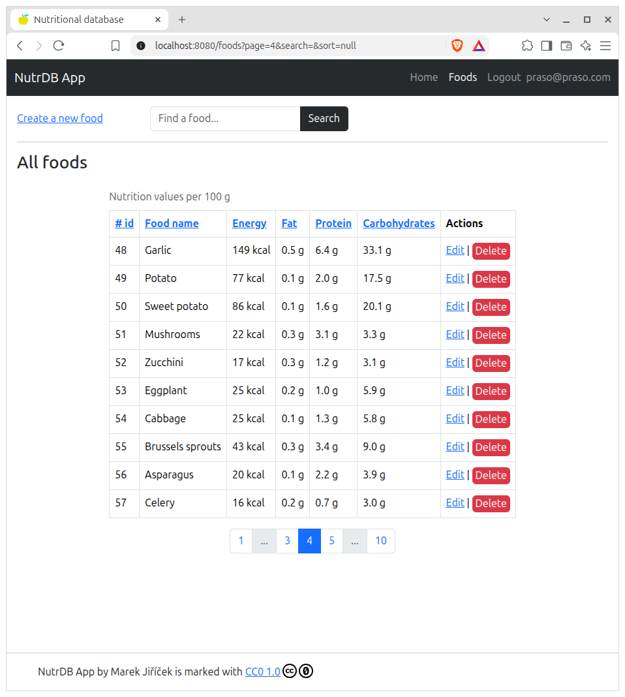
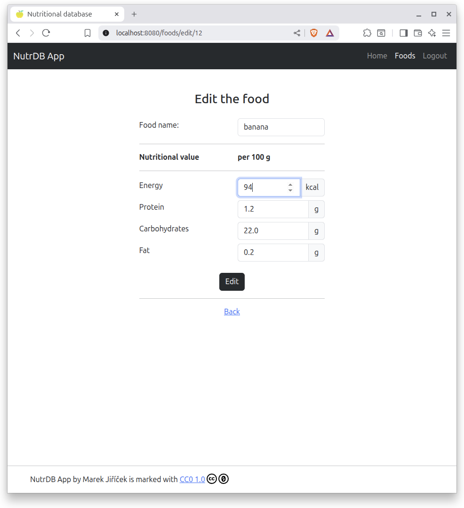
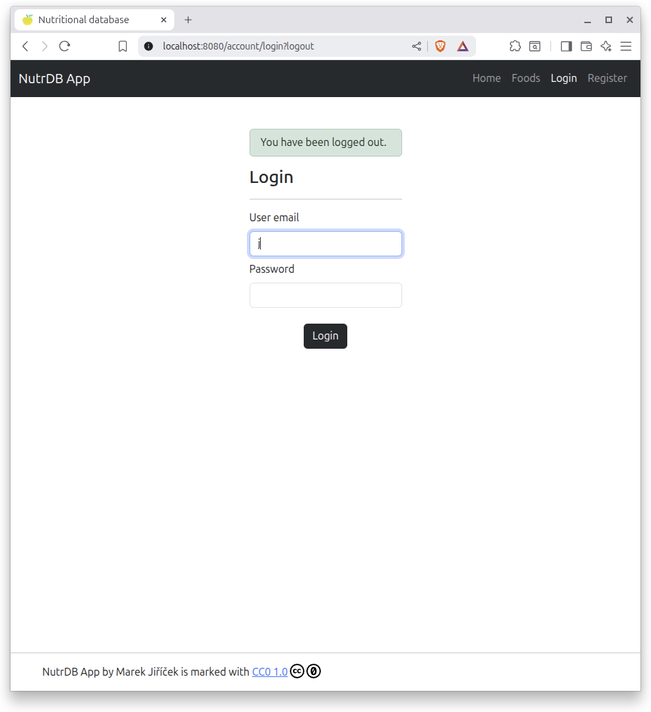

* Project Purpose
- An application for administration of database with nutritional contents of foods (kcal, protein, ...).
- View, create, update and delete foods through a web interface.
- Handles paging, searching and sorting.
- Has registration, login, logout and different user rights.

* Frameworks / Libraries used
- Spring Boot (MVC, Tomcat)
- Hibernate
- PostgreSQL 18
- Thymeleaf template system
- HTML with Bootstrap

* How to run (development)
** Prerequisites
- JDK 25
- Maven or IDE (IntelliJ Idea)
- Docker Engine

** Instructions
1. git clone https://github.com/insighthorizon/nutritional-db-crud.git
2. cd nutritional-db-crud
3. Start PostgreSQL and Adminer with ~docker compose up -d~.
   Use ~sudo~ if your Docker setup requires it.
   On first start, PostgreSQL creates ~nutr_db~.
4. Start the app with ~./mvnw spring-boot:run~ on Linux,
   ~mvnw.cmd spring-boot:run~ on Windows, or run it from IntelliJ IDEA.
5. To interact through the web user interface visit:
    http://localhost:8080
6. Open Adminer at http://localhost:8081 and use these settings.
   | Field    | Value      |
   |----------+------------|
   | System   | PostgreSQL |
   | Server   | ~postgres~ |
   | Username | ~nutr_app~ |
   | Password | ~secret~   |
   | Database | ~nutr_db~  |

   (according to application.properties)

7. To upgrade an account to admin, change the is_admin boolean tag to true (directly from within Adminer)

